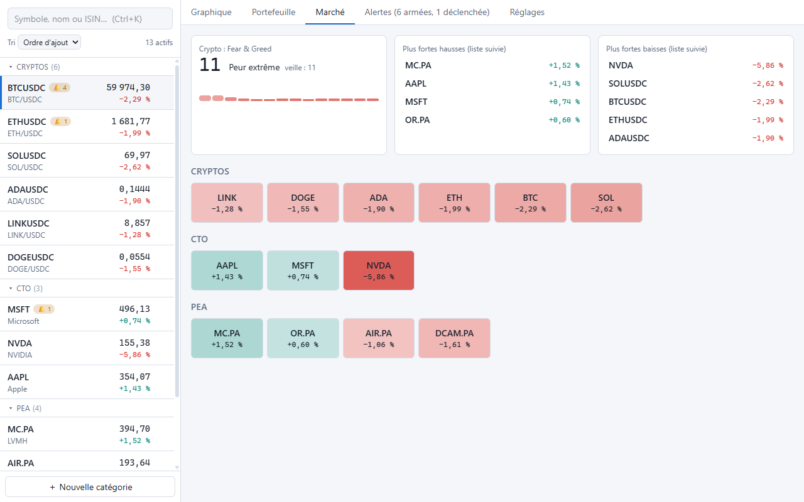

<h1 align="center">Hune</h1>

<strong>Suivez vos cryptos et vos actions sur un seul écran, en local, sans compte ni abonnement.</strong> 
<em>A free, local, read-only desktop app to track crypto and stocks: charts, indicators, alerts, portfolio.</em>

  
  
  
  

  <picture>
    <source media="(prefers-color-scheme: dark)" srcset="docs/captures/graphique-sombre.png">
    
  </picture>

> *La hune : la plateforme en haut du mât d'un navire, d'où l'on guette l'horizon.*

## Pourquoi Hune ?

TradingView et ProRealTime sont devenus payants pour l'essentiel. Hune reprend ce qui sert au quotidien (graphiques, indicateurs, alertes, portefeuille) dans une petite application Windows **gratuite, légère et privée** :

- **Lecture seule** : aucune fonction de trading, aucun accès à un compte de courtier, aucune clé API à fournir.
- **Tout reste chez vous** : watchlist, positions et alertes sont dans un fichier local. Pas de compte, pas de serveur, pas de télémétrie.
- **Ça tourne en arrière-plan** : fermez la fenêtre, Hune continue de surveiller vos alertes depuis la zone de notification et vous prévient par une notification Windows.

## Ce qu'elle sait faire

### Graphiques et indicateurs

Chandeliers (15 min, 1 h, 4 h, 1 j), Heikin-Ashi, ligne ou aire. SMA, EMA, bandes de Bollinger, RSI, MACD, stochastique et volume, tous **paramétrables**, avec échelle logarithmique, légende OHLC et recentrage en un geste. Cryptos en temps réel via Binance, actions via Yahoo Finance (données différées).

### Alertes

Prix, variation en %, RSI, cours qui franchit une moyenne mobile, croisement MACD/signal, croisement de moyennes (golden / death cross). Une alerte se déclenche **une seule fois** puis se réarme d'un clic. Elles sont **tracées sur le graphique**, et un **clic droit** sur le cours crée une alerte à ce niveau.

  <picture>
    <source media="(prefers-color-scheme: dark)" srcset="docs/captures/alertes-sombre.png">
    
  </picture>

### Portefeuille

Saisissez vos lots (quantité, prix d'achat moyen, objectif, plateforme) : Hune calcule la **valeur en euros** (conversion des devises), le **P&L latent**, le poids de chaque ligne, la distance à l'objectif et la répartition par catégorie et par plateforme. Un bouton crée les alertes aux objectifs en un clic.

  <picture>
    <source media="(prefers-color-scheme: dark)" srcset="docs/captures/portefeuille-sombre.png">
    
  </picture>

### Vue d'ensemble du marché

Une carte thermique de votre watchlist par catégorie, les plus fortes hausses et baisses du moment, et l'indice crypto *Fear & Greed*.

  <picture>
    <source media="(prefers-color-scheme: dark)" srcset="docs/captures/marche-sombre.png">
    
  </picture>

### Et aussi

Recherche par **symbole, nom ou ISIN** · **catégories** personnalisables · thèmes clair, sombre ou automatique · raccourcis clavier (`Ctrl+K`, `↑`/`↓`, `1`-`4`, `R`…) · démarrage avec Windows · **sauvegarde** par export/import JSON avec copie automatique quotidienne · **mises à jour automatiques** signées.

> Les captures ci-dessus utilisent un portefeuille **fictif**.

## Installer

1. Téléchargez `Hune_X.Y.Z_x64-setup.exe` depuis la [dernière release](https://github.com/nestyxx/hune/releases/latest).
2. Lancez-le : l'installation se fait pour votre utilisateur, sans droits administrateur.
3. L'installeur n'est pas signé par un certificat de signature de code : **Windows SmartScreen** peut afficher « Windows a protégé votre ordinateur ». Cliquez sur *Informations complémentaires* puis *Exécuter quand même*. Le code source est ici, vous pouvez le relire ou compiler vous-même (voir [CONTRIBUTING.md](CONTRIBUTING.md)).

Prérequis : Windows 10 ou 11 (WebView2, déjà présent sur Windows 11). Hune se met ensuite à jour toute seule : une bannière vous propose l'installation, rien n'est installé sans votre clic.

## Premiers pas

1. Tapez un symbole, un nom ou un ISIN dans la recherche (`Ctrl+K`) : `BTC`, `AAPL`, `LVMH`, `FR0000121014`… puis `Entrée`.
2. Ouvrez l'onglet **Alertes** ou faites un clic droit sur le graphique pour être prévenu à un niveau de prix.
3. Dans **Portefeuille**, ajoutez vos positions pour suivre votre valeur en euros.
4. Dans **Réglages › Sauvegarde**, exportez de temps en temps un fichier JSON : c'est aussi le moyen de changer de poste.

Vous avez déjà vos positions dans un tableur ? Voir [`scripts/importer-excel.py`](scripts/importer-excel.py).

## Confidentialité et réseau

Hune ne contacte que des services publics de données, **sans jamais leur envoyer d'information vous concernant** : Binance (prix crypto), Yahoo Finance (actions et devises), alternative.me (indice Fear & Greed) et GitHub (recherche de mises à jour). Vos données sont dans `%APPDATA%\io.github.nestyxx.hune\hune.json`. Détails dans [SECURITY.md](SECURITY.md).

## Limites à connaître

- **Actions : données différées** (souvent ~15 min). La source est un **endpoint Yahoo Finance non officiel** : il peut changer, être limité ou bloqué sans préavis. L'interface indique « Données différées » ; les cryptos Binance sont en temps réel.
- Les **alertes ne tournent que si Hune est lancée** (fenêtre fermée dans la zone de notification, oui ; application quittée ou Windows en veille, non). Seul l'état courant est évalué.
- Le **4 h** des actions est reconstruit à partir du 1 h, par paquets UTC qui ne suivent pas les horaires de séance.
- **Portefeuille** : PAMP et objectifs sont dans la devise de cotation de l'actif. Une quantité déduite d'un simple montant en euros est **estimée** (marquée « ≈ ») et n'a pas de P&L.
- L'API publique de Binance est inaccessible depuis certains pays (par exemple les États-Unis).
- Seul Windows est pris en charge pour l'instant.

## Avertissement

Hune est un outil d'information et ne fournit **aucun conseil en investissement**. Les cours peuvent être différés, incomplets ou erronés ; le logiciel est fourni « tel quel », sans garantie (voir la [licence](LICENSE)). Vérifiez toujours vos décisions auprès de votre courtier. Hune n'est affilié ni à Binance, ni à Yahoo, ni à TradingView ; ces noms appartiennent à leurs propriétaires.

## Contribuer

Les idées, retours et contributions sont les bienvenus : ouvrez un ticket pour discuter d'une évolution ou signaler un problème. Pour développer, tester et publier une version, voir [CONTRIBUTING.md](CONTRIBUTING.md). L'historique des versions est dans le [CHANGELOG](CHANGELOG.md).

## Licence et remerciements

[MIT](LICENSE). Hune s'appuie sur [Tauri](https://tauri.app), [React](https://react.dev), [Vite](https://vite.dev) et [Tailwind CSS](https://tailwindcss.com).

Graphiques : [TradingView Lightweight Charts™](https://www.tradingview.com/lightweight-charts/) (licence Apache 2.0). Le logo d'attribution TradingView affiché sur les graphiques est exigé par cette licence.
